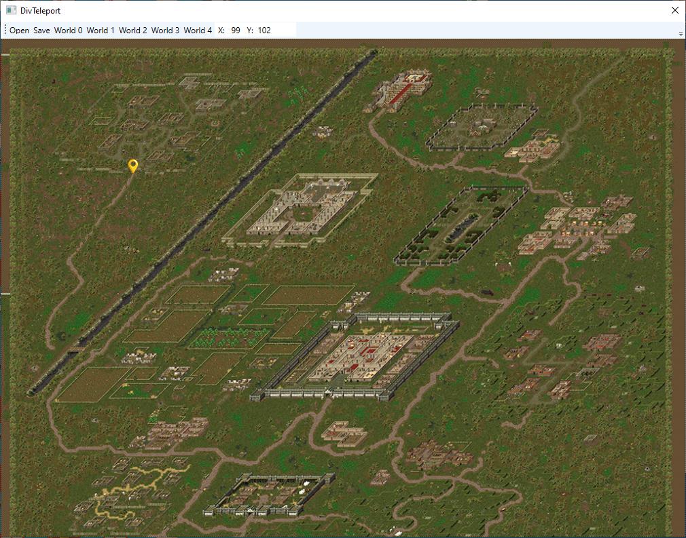

**DivTeleport** — это удобная десктопная утилита для редактирования сохранений игры Divine Divinity, которая позволяет телепортировать персонажа в любую точку на любой игровой карте. 

Если вы застряли в текстурах, хотите быстро переместиться в нужную локацию или просто исследовать мир без ограничений, этот инструмент поможет вам изменить координаты игрока в несколько кликов.

## 🚀 Возможности

* 🗺️ **Поддержка всех карт:** Выбор любой доступной в игре карты мира.
* 🖱️ **Визуальный выбор позиции:** Установка новых координат персонажа простым кликом мыши по карте.
* 💾 **Прямое редактирование сохранений:** Быстрое открытие и сохранение файлов прогресса.

## 📖 Инструкция по использованию

1. **Запуск:** Откройте приложение `DivTeleport`.
2. **Загрузка сохранения:** Нажмите кнопку **"Open"** и выберите файл нужного игрового сохранения.
3. **Выбор локации:** Выберите интересующую вас карту мира.
4. **Телепортация:** Кликните мышкой по карте в том месте, куда хотите переместить персонажа.
5. **Сохранение:** Нажмите кнопку **"Save"** для записи изменений.
6. **Игра:** Запустите игру и загрузите измененное сохранение.

**DivTeleport** is a handy desktop utility for editing Divine Divinity save files that allows you to teleport your character to any point on any game map.
If you are stuck in textures, want to quickly travel to a specific location, or just want to explore the world without limits, this tool will help you change the player's coordinates in just a few clicks.

## 🚀 Features

• 🗺️ **Full Map Support:** Choose any world map available in the game.
• 🖱️ **Visual Position Selection:** Set new character coordinates with a simple mouse click on the map.
• 💾 **Direct Save Editing:** Quickly open and save your progress files.

## 📖 How to Use

1. **Launch:** Open the DivTeleport application.
2. **Load Save:** Click the **"Open"** button and select your desired game save file.
3. **Select Location:** Choose the world map you want to edit.
4. **Teleport:** Click on the map where you want to move your character.
5. **Save:** Click the **"Save"** button to apply the changes.
6. **Play:** Launch the game and load the modified save file.

## ⚖️ Legal Disclaimer / Правовая информация

* **Divine Divinity** and **Beyond Divinity** are registered trademarks of **Larian Studios**.
* All in-game assets, graphics, and data extracted or modified by this tool are the sole property of **Larian Studios**. 
* This project is an unofficial, non-commercial fan tool developed for educational and modding purposes only. It is not endorsed by, affiliated with, or associated with Larian Studios.

---

* Все права на игры **Divine Divinity** и **Beyond Divinity** принадлежат компании **Larian Studios**.
* Игровые ресурсы, графика и данные, извлекаемые или изменяемые данной программой, являются интеллектуальной собственностью **Larian Studios**.
* Данное приложение является неофициальным некоммерческим инструментом для моддинга, создано исключительно в ознакомительных целях и никак не связано с официальными разработчиками.
